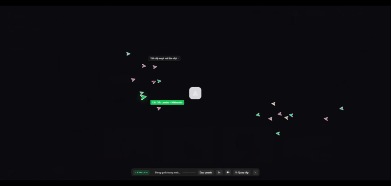

# LiveRebuild by NMstudio ⚡

<p align="center">
  
</p>

<p align="center">
  <b>Biến bất kỳ trang web nào thành canvas trống và chiêm ngưỡng đàn con trỏ chuột đa tác vụ tái lập lại toàn bộ giao diện trực tiếp trước mắt bạn!</b>
</p>

<p align="center">
  <a href="media/demo-liverebuild-14s.mp4">▶️ <b>Xem Clip Demo Tái Tạo Trang 14s (MP4)</b></a> · 
  <a href="media/demo-with-sound.mp4">🔊 <b>Xem Video Có Âm Thanh Phím Cơ (60s)</b></a>
</p>

<p align="center">
  
  
  
  
</p>

---

## 🌟 Những Điểm Đột Phá Trên Bản LiveRebuild (NMstudio Edition)

### 1. 🍏 Con Trỏ Chuột Leader Cốc Cốc Siêu To Bản
- Con trỏ số 1 luôn đảm nhiệm vai trò **Leader Tổng Chỉ Huy** với kích thước mũi tên phóng to **$1.55\times$** (to nhất đàn).
- Mang màu xanh lá thương hiệu Cốc Cốc (`#00b14f`) với vầng hào quang phát sáng `glow drop-shadow`.
- Gắn kèm bảng tên phi hành đoàn phong cách Figma: **`Cốc Cốc Leader • NMstudio`**.
- Không bao giờ bị biến mất (chống idle leave), luôn dẫn dắt phi hành đoàn thi công từ đầu tới cuối.

### 2. 🎧 Âm Thanh Phím Cơ "Creamy Thock" (ASMR)
- Tinh chỉnh thuật toán tổng hợp âm thanh thực qua *Web Audio API* (không cần nạp file mp3 nặng nề).
- Dải tần âm thanh trầm ấm $240–520\text{Hz}$ kết hợp độ vang cộng hưởng đá cẩm thạch $140–220\text{Hz}$, mang lại cảm giác gõ phím cơ bôi dầu (lubed mechanical switch) êm ái, thư giãn và cực kỳ "chill".

### 3. ✨ Hiệu Ứng Bụi Sao (Micro-Confetti & Sparkles)
- Mỗi khi đàn chuột vẽ xong một khối thẻ (Card), khung ảnh hay đoạn văn bản, một chùm 6–8 hạt sao lấp lánh sẽ nổ bung nhẹ nhàng và tan biến trong 0.5s, tạo cảm giác hoàn thành nhiệm vụ cực kỳ mãn nhãn.

### 4. 💬 Bong Bóng Thoại Hóm Hỉnh (Cursor Banter)
- Cứ mỗi 4 giây, Leader hoặc một thành viên trong đàn chuột sẽ bắn ra những câu thoại hoạt hình ngắn vui nhộn:
  - *"Sếp ơi banner này nét căng! ✨"*
  - *"Căn giữa div này mệt ghê... 😅"*
  - *"CSS chuẩn đét từng pixel! 📐"*
  - *"Chạy deadline cùng NMstudio! 🚀"*
  - *"Leader Cốc Cốc đang dẫn đoàn! 🍏"*

### 5. 🎥 Nút 1-Click Quay Clip TikTok / Reels (`🎥 Quay clip`)
- Tích hợp trực tiếp trên thanh điều khiển HUD dưới đáy màn hình.
- Sử dụng native `MediaRecorder API` quay lại toàn bộ quá trình tái tạo với độ phân giải cao $60\text{fps}$. Khi hoàn tất hoặc bấm dừng, video clip định dạng `.webm` sắc nét sẽ tự động tải về máy để bạn đăng ngay lên TikTok / Reels / Shorts mà không cần cài OBS!

### 6. 🎆 Màn Kết Grand Finale Rực Rỡ
- Khi hoàn tất việc xây dựng trang web, trung tâm màn hình sẽ bừng sáng với huy hiệu:
  **`⚡ NMstudio — KIẾN TẠO HOÀN TẤT`**
  kèm theo màn pháo hoa Confetti rực rỡ và hợp âm E major ngân vang trước khi trở lại trang web tương tác thật.

### 7. 🇻🇳 Việt Hóa 100% Giao Diện & Điều Khiển
- Toàn bộ thanh HUD, thanh tiến độ và tooltip đều được Việt hóa chuẩn mực:
  `Dạo quanh (Tour)`, `Tốc độ (1×, 2×, 3×)`, `Âm thanh (M)`, `Quay clip`, `Trở lại trang`, `Tái lập lại`.

### 8. 🛡️ Bảo Mật Tuyệt Đối & Lọc Rác DOM Cốc Cốc
- **100% Offline**: 0 kết nối mạng, 0 theo dõi, 0 thu thập dữ liệu cá nhân.
- Tự động bỏ qua các overlay và thanh tải video của Cốc Cốc (`coccoc-video-downloader`, `coccoc-sidebar`, `coccoc-download-bar`) để đàn chuột không vẽ nhầm giao diện trình duyệt.

---

## 🚀 Hướng Dẫn Cài Đặt Chi Tiết

### Bước 1: Tải mã nguồn
Clone repo này về máy của bạn:
```bash
git clone https://github.com/nghiavu2011/LiveRebuild.git
```

### Bước 2: Cài đặt vào Trình Duyệt

#### 🍏 1. Dành cho Trình duyệt Cốc Cốc
1. Mở Cốc Cốc và truy cập: `coccoc://extensions`
2. Bật công tắc **"Chế độ dành cho nhà phát triển"** (ở góc trên cùng bên phải).
3. Nhấp vào nút **"Tải tiện ích đã giải nén"** (*Load unpacked*).
4. Chọn thư mục:
   ```text
   LiveRebuild/dist/coccoc-extension
   ```
5. Mở bất kỳ trang web nào (ví dụ: [vnexpress.net](https://vnexpress.net) hoặc file test [demo/index.html](demo/index.html)), nhấn **`Alt + Shift + S`** (hoặc bấm vào icon mảnh ghép trên thanh công cụ) để trải nghiệm!

#### 🔵 2. Dành cho Google Chrome / Microsoft Edge / Brave / Opera
1. Mở trang quản lý tiện ích:
   - Chrome: `chrome://extensions`
   - Edge: `edge://extensions`
   - Brave: `brave://extensions`
   - Opera: `opera://extensions`
2. Bật **Developer Mode** $\rightarrow$ Chọn **Load unpacked**.
3. Chọn thư mục tương ứng trong thư mục `dist/` (ví dụ: `dist/chrome-extension` hoặc `dist/edge-extension`).

#### 🦊 3. Dành cho Mozilla Firefox
1. Mở Firefox và truy cập: `about:debugging#/runtime/this-firefox`
2. Bấm nút **"Load Temporary Add-on..."**
3. Chọn file `dist/liverebuild-firefox-nmstudio.zip` (hoặc `dist/firefox-extension/manifest.json`).

---

## 🎮 Hướng Dẫn Sử Dụng & Phím Tắt

- **Kích hoạt / Tắt**: Nhấn **`Alt + Shift + S`** (hoặc click icon trên thanh công cụ).
- **Phím `M`**: Bật / Tắt âm thanh bàn phím cơ.
- **Phím `Esc`**: Thoát ngay lập tức trở lại trang web ban đầu.
- **Dạo quanh (Tour)**: Tự động cuộn trang mượt mà theo tiến độ làm việc của đàn chuột (thích hợp khi quay video màn hình).
- **1× / 2× / 3×**: Điều chỉnh tốc độ thi công của đàn chuột.
- **🎥 Quay clip**: Bắt đầu ghi hình màn hình chất lượng cao để xuất file video clip đăng mạng xã hội.
- **Trở lại trang (Go live)**: Trả lại toàn bộ tính năng click và tương tác cho trang web thật sau khi hoàn tất.

---

## 🛠️ Đóng Gói Lại (Build Pipeline)

Nếu bạn có chỉnh sửa mã nguồn, chỉ cần chạy một lệnh Python duy nhất để build tự động toàn bộ các gói cho mọi trình duyệt:
```bash
python build-multi-browser.py
```
Tất cả các bản build đã giải nén và file nén `.zip` / `.xpi` sẽ được xuất vào thư mục `dist/`.

---

## 👏 Ghi Công & Tác Quyền (Credits & Acknowledgements)

Dự án **LiveRebuild by NMstudio** được phát triển, bản địa hóa và tối ưu hóa bởi **NMstudio** (`nghiavu2011`), kế thừa và lấy cảm hứng từ những công trình sáng tạo tuyệt vời của cộng đồng mã nguồn mở:
- **[Joel Califa](https://joelcalifa.com)** ([@califa](https://github.com/califa)) — Tác giả nguyên bản của **[Swarm](https://califa.github.io/swarm-site/)**: Thiết kế chuyển động, cơ chế bầy đàn boids, tọa độ vector con trỏ và nghệ thuật thị giác.
- **[Dhvanil Patel](https://github.com/DhvanilPatel)** — Tác giả bản Chrome extension ban đầu (**[swarm-cursors](https://github.com/DhvanilPatel/swarm-cursors)**).
- **[S488U](https://github.com/S488U)** — Tác giả bản port Firefox (**[cursor-craft](https://github.com/S488U/cursor-craft)**).

---

## 📄 Bản Quyền (License)

Dự án được bảo tồn và chia sẻ công khai nhằm mục đích học tập, nghiên cứu và tôn vinh nghệ thuật lập trình sáng tạo.

**Phát triển và duy trì bởi NMstudio (2026)**.
