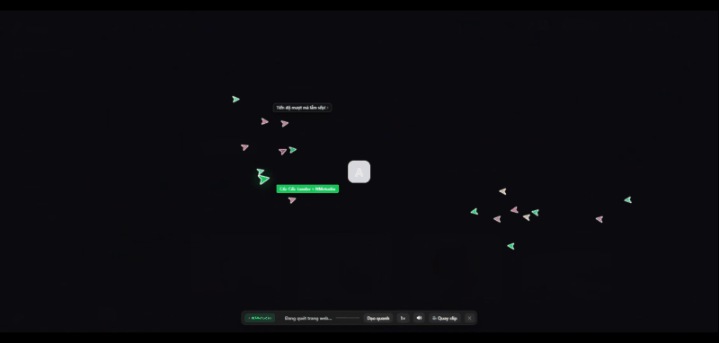

# LiveRebuild by NMstudio ⚡

<p align="center">
  
</p>

<p align="center">
  <b>Biến bất kỳ trang web nào thành canvas trống và chiêm ngưỡng đàn con trỏ chuột đa tác vụ tái lập lại toàn bộ giao diện trực tiếp trước mắt bạn!</b>
</p>

<p align="center">
  <a href="media/demo-liverebuild-14s.mp4">▶️ <b>Xem Clip Demo Tái Tạo Trang 14s (MP4)</b></a> · 
  <a href="media/demo-with-sound.mp4">🔊 <b>Xem Video Có Âm Thanh Phím Cơ (60s)</b></a>
</p>

---

## 🌟 Những nâng cấp đột phá của NMstudio Edition

### 🎨 Gói 1: Nghệ Thuật Cảm Xúc (Emotional Craft & ASMR)
1. **✨ Hiệu ứng Hạt Bụi Sao (Micro-Confetti & Sparkles)**:
   - Khi đàn chuột hoàn tất một khối hộp, thẻ card hay hình ảnh, các hạt sao lung linh đa sắc sẽ nổ bung nhẹ nhàng và tan biến trong 0.5s, tạo cảm giác hoàn thành nhiệm vụ cực kỳ đã mắt.
2. **🎧 Âm Thanh Phím Cơ "Creamy Thock" (ASMR)**:
   - Tổng hợp âm thanh Web Audio được tinh chỉnh sâu với dải tần trầm ấm 240–520Hz và cộng hưởng đá cẩm thạch 140–220Hz. Nghe đầm, êm ái, bôi trơn cao cấp (lubed switch), thư giãn đỉnh cao khi làm việc đêm khuya.
3. **💬 Bong Bóng Thoại Hóm Hỉnh (Cursor Banter)**:
   - Cứ mỗi 4 giây, Leader hoặc một chú chuột ngẫu nhiên sẽ bắn ra những câu thoại hoạt hình ngắn vui nhộn:
     - *"Sếp ơi banner này nét căng! ✨"*
     - *"Căn giữa div này mệt ghê... 😅"*
     - *"CSS chuẩn đét từng pixel! 📐"*
     - *"Chạy deadline cùng NMstudio! 🚀"*
     - *"Gõ phím cơ mỏi cả tay... ⌨️"*
     - *"Leader Cốc Cốc đang dẫn đoàn! 🍏"*

### 🎥 Gói 2: Vũ Khí Truyền Thông (Social Viral & Grand Finale)
4. **🎥 Nút 1-Click Quay Clip TikTok / Reels (`🎥 Quay clip`)**:
   - Tích hợp sẵn trên thanh điều khiển HUD. Khi bấm, tiện ích sử dụng native `MediaRecorder` ghi lại video màn hình sắc nét 60fps. Khi bấm dừng hoặc khi vẽ xong, video `.webm` sẽ tự động tải về máy để bạn đăng ngay lên TikTok / Reels / Shorts mà không cần OBS!
5. **🎆 Màn Kết Grand Finale Rực Rỡ**:
   - Khi hoàn thành trang web, trung tâm màn hình sẽ xuất hiện huy hiệu phát sáng `⚡ NMstudio - Kiến Tạo Hoàn Tất`, kèm theo cơn mưa pháo hoa hạt sáng confetti và âm thanh hợp âm E major ngân vang trước khi trở lại trang web thật.

### 🌐 Gói 3: Tương Thích & Bản Sắc Trình Duyệt
6. **👑 Con trỏ chuột Leader Cốc Cốc Siêu To Bản**:
   - Mũi tên to gấp **$1.55\times$**, màu xanh lá Cốc Cốc `#00b14f` phát quang kèm bảng tên phi hành đoàn `Cốc Cốc Leader • NMstudio`.
7. **🇻🇳 Việt Hóa 100% Giao Diện & Điều Khiển**:
   - `Dạo quanh (Tour)`, `Tốc độ (1×, 2×, 3×)`, `Âm thanh (Phím M)`, `Quay clip`, `Trở lại trang`, `Tái lập lại`.
8. **🛡️ Lọc Sạch Rác DOM Cốc Cốc**:
   - Tự động bỏ qua các overlay của Cốc Cốc (`coccoc-video-downloader`, `coccoc-sidebar`, `coccoc-download-bar`).

---

## 📁 Cấu trúc bản Build trong thư mục `dist/`

| Trình duyệt | Thư mục Unpacked (Để cài ngay) | File nén đóng gói |
| :--- | :--- | :--- |
| 🍏 **Cốc Cốc** (Khuyên dùng) | `dist/coccoc-extension/` | `dist/liverebuild-coccoc-nmstudio.zip` |
| 🔵 **Google Chrome** | `dist/chrome-extension/` | `dist/liverebuild-chrome-nmstudio.zip` |
| 🔷 **Microsoft Edge** | `dist/edge-extension/` | `dist/liverebuild-edge-nmstudio.zip` |
| 🔴 **Opera** | `dist/opera-extension/` | `dist/liverebuild-opera-nmstudio.zip` |
| 🦁 **Brave** | `dist/brave-extension/` | `dist/liverebuild-brave-nmstudio.zip` |
| 🌐 **Universal Chromium** | `dist/universal-extension/` | `dist/liverebuild-universal-nmstudio.zip` |
| 🦊 **Mozilla Firefox** | `dist/firefox-extension/` | `dist/liverebuild-firefox-nmstudio.xpi` |

---

## 🚀 Hướng Dẫn Cài Đặt Trải Nghiệm Trên Cốc Cốc

1. Mở Cốc Cốc, gõ vào thanh địa chỉ: `coccoc://extensions`
2. Bật công tắc **"Chế độ dành cho nhà phát triển"** (góc trên bên phải).
3. Nhấp nút **"Tải tiện ích đã giải nén"** (*Load unpacked*).
4. Chọn thư mục:
   ```text
   LiveRebuild/dist/coccoc-extension
   ```
5. Mở bất kỳ trang web nào (ví dụ [vnexpress.net](https://vnexpress.net), [dantri.com.vn](https://dantri.com.vn) hoặc [demo/index.html](demo/index.html)) và nhấn tổ hợp phím **`Alt + Shift + S`**!

---

## 🛠️ Lệnh Tái Đóng Gói (Rebuild)
```bash
python build-multi-browser.py
```

---

## 👏 Ghi Công & Tác Quyền (Credits)
Phát triển & tối ưu bởi **NMstudio** (`nghiavu2011`). Cảm ơn công trình sáng tạo gốc của Joel Califa, Dhvanil Patel và S488U.
